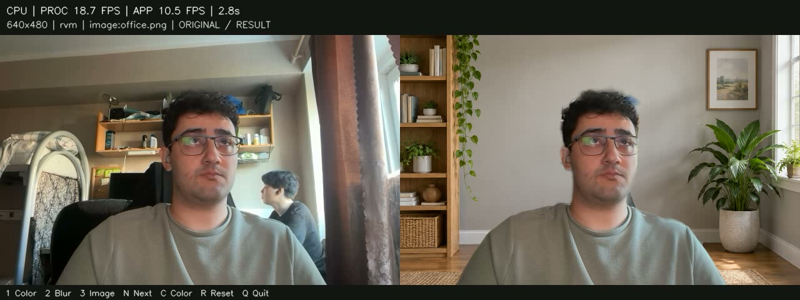

# Background Removal in Real Time

Удаление и замена фона видеопотока на CPU. Приложение получает кадры с веб-камеры или из файла, выделяет человека и показывает результат в окне. Доступны однотонный фон, изображение и размытие.



Кадр на 2,8 секунды из запуска RVM с одним потоком. Измерения этого запуска приведены в [results/rvm_1_thread.json](results/rvm_1_thread.json).

## Выбранное решение

Основная модель — [Robust Video Matting (RVM)](https://github.com/PeterL1n/RobustVideoMatting), вариант MobileNetV3 в формате FP32 ONNX. Она использует свёрточный энкодер и рекуррентный декодер с ConvGRU. Четыре состояния передаются между соседними кадрами, что помогает сохранять маску во времени. Модель возвращает прозрачность `alpha` и цвета переднего плана `foreground`:

```text
result = foreground * alpha + background * (1 - alpha)
```

Инференс выполняется через ONNX Runtime с `CPUExecutionProvider`. Обучение не требуется. Веса находятся в `models/`; при запуске проверяется их SHA-256. После установки зависимостей приложение работает без интернета.

RVM выбран по результатам сравнения с MediaPipe: на проверенной последовательности он лучше сохранял поднятую ладонь. MediaPipe оставлен как более быстрый альтернативный вариант для слабых CPU.

При кадре 640×480 и `--downsample-ratio 0.4` первый этап RVM работает примерно в разрешении 256×192, затем результат уточняется до 640×480. Композитинг также выполняется в полном разрешении. Инференс запускается на каждом кадре.

## Установка

Нужен 64-битный Python 3.10–3.12. Команды выполняются из корня проекта.

### macOS / Linux

```bash
python3.10 -m venv .venv
source .venv/bin/activate
python -m pip install -r requirements.txt
python -m pip check
```

Можно использовать `python3.11` или `python3.12`. На Apple Silicon нужен Python для ARM64.

### Windows PowerShell

```powershell
py -3.10 -m venv .venv
.\.venv\Scripts\python.exe -m pip install -r requirements.txt
.\.venv\Scripts\python.exe -m pip check
.\.venv\Scripts\python.exe app.py --camera 0 --mode image
```

В остальных примерах под Windows замените `python` на `.\.venv\Scripts\python.exe`.

## Запуск

Веб-камера и фон комнаты из комплекта:

```bash
python app.py --camera 0 --mode image
```

Другие варианты:

```bash
python app.py --mode color --color 40,100,180
python app.py --mode blur
python app.py --mode image --background backgrounds/office.png
python app.py --input video.mp4 --mode image
python app.py --view result --mirror
```

По умолчанию обрабатывается кадр 640×480. Слева отображается исходник, справа — результат; размер такого окна 1280×480. При других пропорциях входной кадр обрезается по центру и масштабируется без растяжения. Файлы воспроизводятся с учётом FPS источника.

### Параметры

| Параметр | Назначение | По умолчанию |
|---|---|---|
| `--camera` | Индекс веб-камеры | `0` |
| `--input` | Видеофайл вместо камеры | — |
| `--width`, `--height` | Размер обрабатываемого кадра | `640`, `480` |
| `--mode` | Фон: `color`, `image`, `blur` | `color` |
| `--color` | Цвет в формате R,G,B | `40,100,180` |
| `--background` | Файл фонового изображения | — |
| `--background-dir` | Папка с фоновыми изображениями | `backgrounds/` |
| `--rvm-threads` | Число потоков ONNX Runtime | До `8`, по числу логических CPU |
| `--downsample-ratio` | Внутренний масштаб RVM | `0.4` |
| `--view` | Отображение: `split`, `result`, `mask` | `split` |
| `--mirror` | Зеркальное отражение | Выключено |
| `--seconds` | Длительность после прогрева; `0` — без ограничения | `0` |
| `--output` | Запись результата в MP4 или AVI | — |
| `--metrics` | Файл измерений | `outputs/metrics.json` |

Полный список: `python app.py --help`. Параметры `--camera` и `--input` используются по отдельности. Для фонов поддерживаются JPG, JPEG, PNG, WEBP и BMP; в приложении также есть три градиента.

### Управление в окне

| Клавиша | Действие |
|---|---|
| `1` / `2` / `3` | Цвет / размытие / изображение |
| `N` | Следующее изображение |
| `C` | Следующий цвет |
| `R` | Сброс памяти модели после смены сцены |
| `Q` / `Esc` | Выход и сохранение измерений |

Для букв нужна английская раскладка и фокус на окне приложения.

## Производительность

Измерения выполнены на **Apple M4 Pro, 12 логических CPU**, macOS 26.4.1 ARM64, Python 3.10.19. Версии: ONNX Runtime 1.20.1, OpenCV 4.11.0, NumPy 1.26.4. Источник — веб-камера, исходный и обрабатываемый кадр 640×480, фон — `office.png`, масштаб RVM — 0.4, OpenCV — один поток. Окно и запись видео включены.

| Метрика | 1 поток RVM | 8 потоков RVM |
|---|---:|---:|
| FPS обработки: сегментация и композитинг | 18.64 | **50.98** |
| FPS всего приложения | 10.16 | **16.41** |
| Средняя latency обработки, мс | 53.65 | **19.62** |
| p95 latency обработки, мс | 54.82 | **23.66** |
| Измеренных кадров | 153 | 247 |
| Длительность измерения, с | 15.06 | 15.05 |

Исходные данные: [один поток](results/rvm_1_thread.json), [восемь потоков](results/rvm_8_threads.json). Эти значения относятся к указанному устройству и коротким запускам; на другом CPU скорость может отличаться.

Первые 30 кадров исключаются как прогрев. Используется `time.perf_counter()`:

- **Processing FPS** — количество завершённых кадров, делённое на сумму времени подготовки кадра, инференса, обработки маски и композитинга.
- **Application FPS** — количество завершённых кадров, делённое на сумму времени полного цикла, включая захват, обработку, надписи, запись и отображение.

Частота камеры и FPS записанного файла не используются как оценка производительности. Запись сохраняет реальную длительность, при необходимости повторяя готовые кадры; повторы не учитываются в измеренном количестве обработанных кадров.

Повторить замер и записать 15 секунд после прогрева:

```bash
python app.py --camera 0 --backend rvm --rvm-threads 8 --mode image --seconds 15 --output outputs/demo.mp4 --metrics outputs/metrics.json
```

Для обработки файла без окна и ограничения воспроизведения:

```bash
python app.py --input video.mp4 --headless --unpaced --metrics outputs/benchmark.json
```

## Качество результата

В демонстрации сохраняются основной силуэт, поднятая рука и движения головы. На границах волос и при быстрых движениях возможны мягкие края и ореолы; часть кресла иногда остаётся в переднем плане. Качество оценивалось визуально по записи с камеры. IoU и Dice не измерялись, поскольку для этой записи нет размеченных масок.

Если скорость недостаточна, можно подобрать `--rvm-threads`, уменьшить `--downsample-ratio` до 0.3 или использовать MediaPipe. После изменения масштаба следует повторно оценить границы и движения рук. Разрешение можно снизить до 480×360, указав это в новых измерениях.

## Демо

[Видео с веб-камеры, 15 секунд](demo/demo.mp4): слева исходный кадр, справа замена фона; на экране показаны FPS обработки и всего приложения. Запуск выполнен с восемью потоками RVM. Видео сохранено в H.264 MP4; при загрузке проекта в публичный репозиторий оно доступно по этой ссылке.

## Альтернативный backend: MediaPipe

[MediaPipe Selfie Segmentation](https://github.com/google-ai-edge/mediapipe/blob/master/docs/solutions/selfie_segmentation.md) — лёгкая CNN на базе MobileNetV3. Для неё зависимости устанавливаются отдельно:

```bash
python -m pip install -r requirements-mediapipe.txt
python app.py --backend mediapipe --model 1 --mode image
```

`--model 1` использует внутренний размер 256×144, `--model 0` — 256×256. Применяются guided filter, сглаживание между кадрами и мягкий порог маски. Параметры `--model`, `--mask-filter`, `--smooth`, `--threshold`, `--feather` относятся к MediaPipe; `--rvm-threads` и `--downsample-ratio` — к RVM.

## Возможные проблемы

- **Камера не открывается:** разрешите доступ к камере терминалу или IDE, закройте другие приложения, попробуйте `--camera 1`.
- **Linux без графических библиотек:** установите `libgl1` и `libglib2.0-0`. Для показа результата нужна графическая сессия; `--headless` отключает окно.
- **Ошибка MediaPipe:** используйте отдельное окружение Python 3.10–3.12 и `requirements-mediapipe.txt`. В среде без графического контекста этот backend может не запускаться даже при CPU-инференсе; основной RVM от него не зависит.
- **Ошибка записи MP4:** попробуйте `--output outputs/demo.avi`. Для перевода в H.264 при наличии FFmpeg: `ffmpeg -i outputs/demo.avi -c:v libx264 -pix_fmt yuv420p -movflags +faststart outputs/demo.mp4`.

## Структура проекта

```text
app.py                     захват, обработка, окно, запись и измерения
rvm.py                     инференс RVM через ONNX Runtime
backgrounds.py             подготовка и переключение фонов
models/                    веса модели
backgrounds/               фон комнаты
demo/                      видео и снимок результата
results/                   измерения на M4 Pro
tests/                     тесты композитинга и измерений
outputs/                   результаты новых запусков, исключены из Git
requirements.txt           зависимости основного решения
requirements-mediapipe.txt  зависимости альтернативного backend
```

Проверка:

```bash
python -m unittest discover -s tests -v
```

Тесты проверяют композитинг, масштабирование кадра, расчёт FPS, запись видео и переключение фонов.

## Лицензия и источники

Проект распространяется под [GPL-3.0](LICENSE). Сведения о сторонних моделях и ресурсах: [ASSETS.md](ASSETS.md).
